  

## Hi, I'm Nahuel 👋

I'm a software engineer from Buenos Aires, Argentina. I spent my first years building for the web, and somewhere along the way I fell in love with what happens inside old consoles. These days most of my free time goes into reverse engineering games, working on decompilations, and writing mods and homebrew for hardware that was never designed to run them.

There's something special about opening up a game from twenty years ago and slowly figuring out how it thinks. That's the part I enjoy the most, and it's what I want to keep doing.

## What I'm working on

**[dsi-retroachievements](https://github.com/NahuelGenchi/dsi-retroachievements)** brings RetroAchievements to the Nintendo DSi. It's my main project right now, and I'll be sharing progress as it moves forward.

**[kirbys-dead-land](https://github.com/NahuelGenchi/kirbys-dead-land)** is my other project in the works. More on it soon.

## Let's build something

If you're working on a decomp, a mod or a homebrew project and could use an extra pair of hands, or you just have an idea you'd like to talk through, I'd love to hear from you. My DMs are open on [X](https://x.com/NahuelGenchi), and you can also find me on [LinkedIn](https://linkedin.com/in/nahuel-genchi).

  

